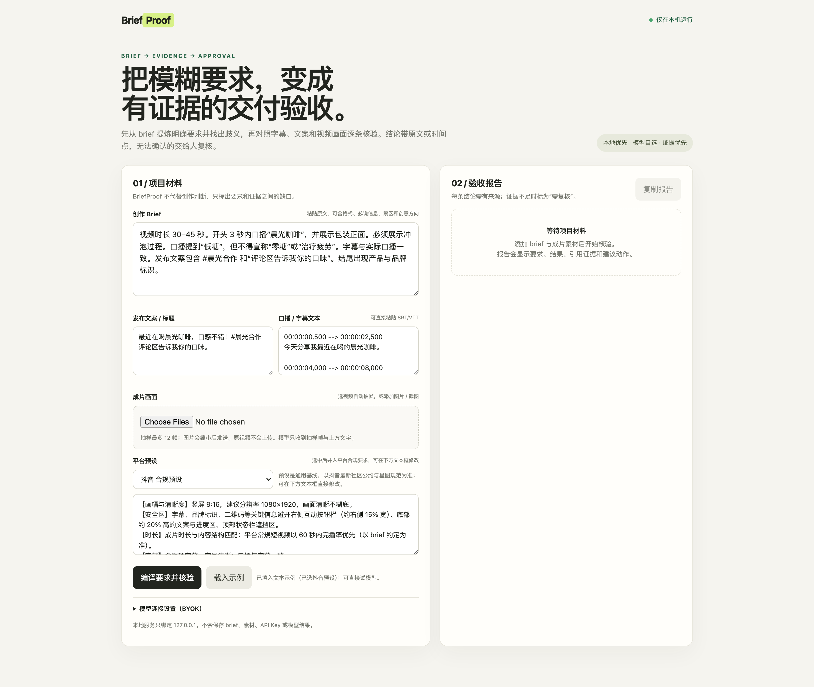
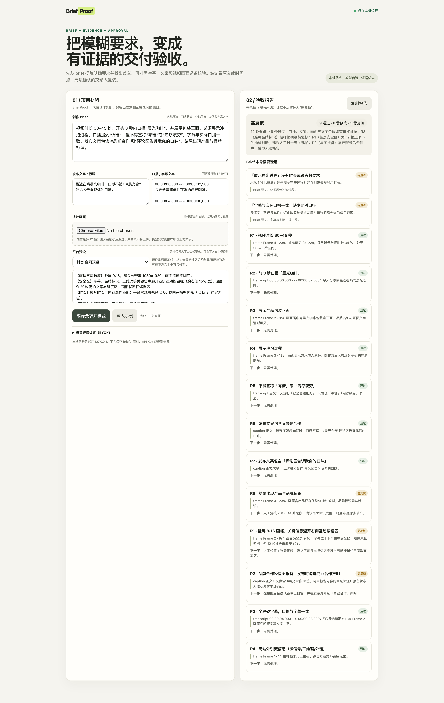

# BriefProof

**An evidence-first local acceptance tool for creator deliverables.** Turn a loose campaign brief into an editable requirement list, find ambiguity before production, then check the final video, transcript/subtitles, and publish copy against each requirement with a quote or frame reference.

BriefProof is an open-source, agent-friendly alternative for people who need transparent checks without handing an entire campaign archive to a hosted review platform. It does not promise an automatic approval: evidence gaps and subjective checks stay marked for human review.

[English](#english) | [中文](#中文)

## Screenshots

| | |
|---|---|
|  |  |

## Why this exists

Creator video tools are good at generation, clipping, and editing. Campaign review products already compare creator posts with brand briefs. The gap we are targeting is a small, inspectable workflow that is local-first, works from a brief the user already has, and exposes every requirement and evidence reference so a creator or agent can fix the right thing.

This is an initial product hypothesis, not a claim that the category is empty or that 10,000 users are guaranteed. See [the research note](docs/market-research.md) for the opportunity, competition, and limits of the market scan.

## Start

Requires Python 3.9+; no package installation is needed.

```bash
python3 server.py
```

Open <http://127.0.0.1:8765>, paste a brief, add publish copy and transcript/subtitles, then add a video or still images. Enter a model name and an API key for a compatible multimodal chat-completions endpoint. BriefProof samples at most 12 frames in your browser and sends the sampled stills plus text to the endpoint you configured; it never sends the original video file. Export the result by using “Copy report.”

API keys are held in the page's memory and sent only to the local proxy for that request. BriefProof does not write the key or analysis materials to disk. The model provider may retain request data under its own terms; use a provider and endpoint you trust.

## What it does

1. Extracts requirements from the original brief and keeps an excerpt for each one.
2. Separates hard requirements, preferences, and creative direction.
3. Flags ambiguous or conflicting requirements before treating them as pass/fail checks.
4. Checks caption, transcript/subtitles, and sampled frames against the requirement list.
5. Optional platform presets (Douyin included) merge platform-compliance rules — aspect ratio and safe areas, branded-content declaration, banned absolute claims, no off-platform funnels — into the same evidence-backed checks. Presets are editable text, not a hardcoded gate.
6. Returns `pass`, `fail`, or `review` per requirement with a quote or frame/time reference and a suggested next action.
7. Includes an installable [Agent Skill](SKILL.md) with the same evidence rules for Claude Code, Codex, and other compatible agents.

## Current limits

- BYOK model required; the quality and cost depend on the selected provider/model.
- Frame sampling is intentionally capped at 12 frames. Fine-print or very brief visual details can be missed and must remain `review`.
- Speech checks use supplied transcript/subtitles. BriefProof does not yet transcribe audio.
- The current checker is a decision aid, not a legal review, platform-policy guarantee, or substitute for human approval.
- Supported API shape: OpenAI-compatible `/chat/completions` with image inputs.

## Privacy

The web server binds to `127.0.0.1`. It does not persist the brief, frames, credentials, or report. Only the resized sampled stills and entered text are sent to the model endpoint specified by the user. A compatible remote endpoint receives those materials; use a local model endpoint when sensitive material must stay on the device.

## License

MIT. See [LICENSE](LICENSE).

---

[English](#english) | [中文](#中文)

## 中文

**BriefProof**：面向创作者交付物的本地验收工具，证据优先。把一段松散的合作 brief 变成可编辑的要求清单，先发现歧义，再对照成片视频、口播/字幕和发布文案逐条核验，每条结论都带原文引用或画面时间点。

不需要把整包素材交给托管审核平台；所有检查在本机运行，每条要求与证据引用完全透明，创作者或 agent 都能据此修改正确的地方。它不承诺自动通过：证据缺口和主观项会保持「需复核」状态，留给人判断。

### 截图

| | |
|---|---|
|  |  |

### 为什么做这个

创作者视频工具擅长生成、剪辑和切条；面向品牌的营销审核产品已经在对比创作者内容与 brief。我们要补的位置是一个小型、可检查的工作流：本地优先，直接使用你手里已有的 brief，展示每条要求与证据引用，让创作者或 agent 能改对地方。

这是初始产品假设，不宣称品类空白，也不保证用户规模。机会、竞争与调研边界见[调研笔记](docs/market-research.md)。

### 开始

需要 Python 3.9+，无需安装任何依赖。

```bash
python3 server.py
```

打开 <http://127.0.0.1:8765>，粘贴 brief，填入发布文案与口播/字幕，再添加视频或截图。填入一个支持图像输入的 OpenAI 兼容接口的模型名与 API Key。BriefProof 在浏览器内最多抽样 12 帧，只把抽样帧与文字发往你配置的接口，不会上传原视频。结果用「复制报告」导出。

API Key 只保存在页面内存，仅当次请求经过本地代理转发。BriefProof 不把 Key 或分析素材写入磁盘。模型服务商可能按自己的条款保留请求数据；敏感素材请使用本机模型接口。

### 它做什么

1. 从 brief 原文提炼要求，每条保留原文摘录。
2. 区分硬性要求、偏好与创意方向。
3. 在把要求当作 pass/fail 检查之前，先标出模糊或矛盾项。
4. 对照要求清单核验文案、口播/字幕与抽样画面。
5. 可选平台合规预设（内置抖音）：画幅与安全区、商业内容报备声明、极限词禁用、站外引流检查等规则并入同一套证据核验；预设是可编辑文本，不是硬编码门槛。
6. 每条要求返回 `pass` / `fail` / `review`，附引用或时间点，以及建议的下一步动作。
7. 内置可安装的 [Agent Skill](SKILL.md)，同一套证据规则可用于 Claude Code、Codex 等兼容 agent。

### 当前限制

- 需要 BYOK 自备模型；质量与成本取决于所选服务商与模型。
- 抽帧上限为 12 帧。细小文字或一闪而过的画面可能漏检，必须保持 `review`。
- 语音核验依赖你提供的口播/字幕文本，BriefProof 暂不做音频转写。
- 当前检查器是决策辅助，不是法律意见、平台合规保证或人工审批的替代。
- 支持的接口形态：OpenAI 兼容的 `/chat/completions`，带图像输入。

### 隐私

Web 服务只绑定 `127.0.0.1`，不落盘 brief、画面、凭证或报告。仅缩小后的抽样帧与输入文字会发往你指定的模型接口；敏感素材请使用本机模型端点。

### 许可

MIT，见 [LICENSE](LICENSE)。
